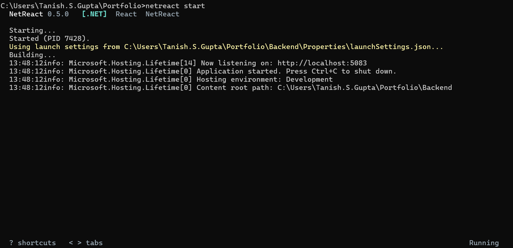
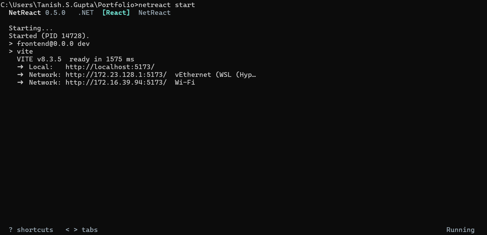
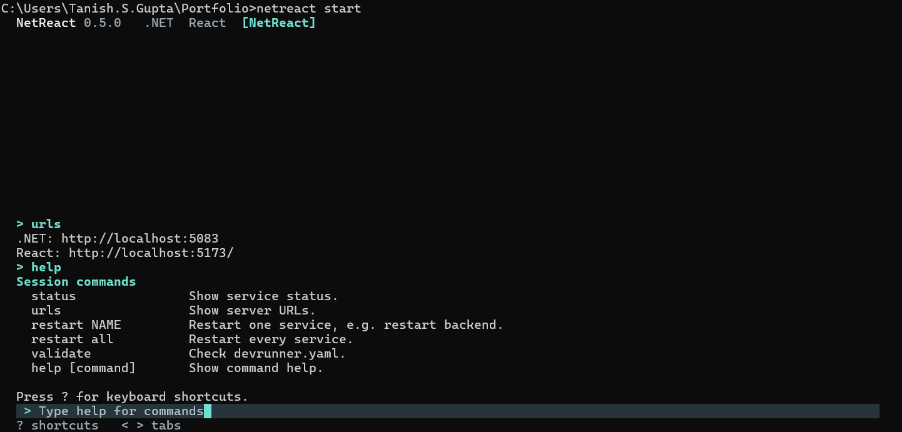
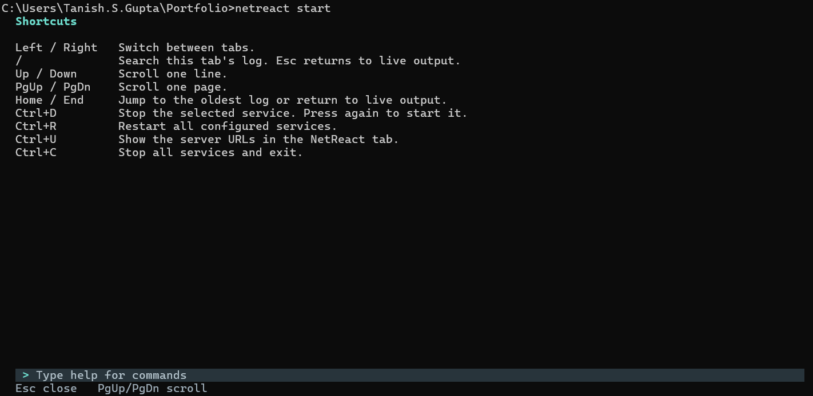

<h1 align="center">
  
</h1>

[](https://dotnet.microsoft.com/download/dotnet/11.0)
[](https://react.dev/)
[](LICENSE)

Run an ASP.NET Core API and a React dev server from one terminal. Switch between their logs with the arrow keys, press **Ctrl+U** to see both URLs, or restart just the backend while the frontend keeps running.

[Install](#install-netreact) · [Set up your app](#set-up-your-own-app) · [YAML reference](#configuration-reference) · [Interactive CLI](#interactive-cli) · [Troubleshooting](#troubleshooting)

## Install NetReact

You need the **.NET 11 SDK** to build the tool. For a React frontend, install npm and the Node.js version required by your application. Your backend also needs an SDK compatible with its project. Check your terminal with:

```sh
dotnet --list-sdks
node --version
npm --version
```

From the **NetReact source repository** (the folder containing `NetReact.DevRunner.slnx`), build the package and install it as a global .NET tool:

```sh
dotnet pack ./src/NetReact.DevRunner.Cli/NetReact.DevRunner.Cli.csproj -c Release -o ./artifacts/nuget
dotnet tool install --global NetReact.DevRunner --version 0.5.0 --source ./artifacts/nuget
netreact --version
```

The last command should print `0.5.0`. This installation makes `netreact` available across your projects. Your application's `.csproj` needs no package reference. If you already have an older version installed, close active NetReact sessions and substitute `dotnet tool update` for `dotnet tool install` in the second command.

## Set up your own app

### 1. Open your application root

Open the folder containing your backend and frontend in VS Code, then open its terminal. For example, the following app has an API in `Backend` and an npm project in `frontend`:

```text
Portfolio/
  Backend/
    Portfolio.Api.csproj
  frontend/
    package.json
```

### 2. Generate and check the configuration

```sh
netreact init
```

NetReact creates `devrunner.yaml` in the current folder. It looks up to three folder levels deep for an ASP.NET Core web project and a `package.json` with a `dev` script. When it finds one match for a service, it fills in that path for you. If it prints **check this path**, set that service's `workingDirectory` yourself. If a configuration already exists, open it directly.

For this layout, the backend runs in `./Backend` and the frontend runs in `./frontend`. See the annotated [configuration reference](#configuration-reference) or copy the [YAML template](devrunner.example.yaml) into your application as `devrunner.yaml`.

### 3. Install frontend dependencies and check both services

From your app root, use the frontend path you chose in step 2:

```sh
npm install --prefix ./frontend
netreact doctor
```

Look for `Service checks passed.` The doctor checks the configuration, service directories, executable availability, .NET SDK selection, and configured npm script.

### 4. Start your session

```sh
netreact start
```

This runs `dotnet run` for the sample backend and `npm run dev` for its frontend. To use .NET Hot Reload, start with `netreact start --watch`. To work on the backend alone, use `netreact start backend --watch`. A supported C# edit applies when you save.

## Configuration reference

Each key under `services` is a name you choose. For example, `backend` is the name used in `netreact start backend --watch` and in the interactive command `restart backend`.

```yaml
# Place this file beside your backend and frontend folders as devrunner.yaml.
version: 1
services:
  backend:
    workingDirectory: ./Backend       # Folder containing the web .csproj
    command: dotnet
    args: [run]
    # If your API serves this endpoint, uncomment it to enable a readiness check.
    # readyUrl: http://localhost:5083/health

  frontend:
    workingDirectory: ./frontend      # Folder containing package.json
    command: npm
    args: [run, dev]
```

| Setting | Meaning |
| --- | --- |
| `version` | Required. Use `1` for the configuration schema. |
| `workingDirectory` | Required for each service. The CLI launches the executable in this folder. Relative paths start at the directory containing the YAML file. |
| `command` | Required. The executable to launch, such as `dotnet` or `npm`. |
| `args` | Optional list of arguments in order. For a specific project, use `[run, --project, "Store API.csproj"]`. The file name is one argument. |
| `readyUrl` | Optional HTTP or HTTPS endpoint. The first 2xx response changes the service status to **Ready**. |

**Choosing a working directory**

| Where the project lives | Value in YAML |
| --- | --- |
| The web `.csproj` is next to `devrunner.yaml` | `workingDirectory: .` |
| The web project is in `src/Store.Api/` | `workingDirectory: ./src/Store.Api` |
| The frontend manifest is in `Client App/package.json` | `workingDirectory: "./Client App"` |
| The config is in `config/dev.yaml` and the frontend is its sibling directory `frontend/` at the app root | `workingDirectory: ../frontend` |

Match the capitalization on disk so the same file works across platforms. When using `netreact start --config ./config/dev.yaml`, the CLI still resolves service paths from `config/`. Review configurations before running them because each command runs with your account's permissions.

## Interactive CLI

### .NET tab — read the backend log

Use **Left/Right** to select **.NET**. Look for `Now listening on` to find the API address. In this Portfolio session it is `http://localhost:5083`. Your app's launch settings determine its address.

[](https://github.com/user-attachments/assets/65d2fd9d-40b3-4dff-8ef7-83b8583e9697)

### React tab — open the frontend

Switch to **React** and open Vite's **Local** URL in your browser. This session uses `http://localhost:5173/`. The tab also shows frontend build errors and reload messages while you work.

[](https://github.com/user-attachments/assets/86627c95-4111-417b-9a56-15b31b3944f6)

### NetReact tab — manage the session

Press **Ctrl+U** to open **NetReact** and list detected URLs. At the prompt, type `status` to see service states, `restart backend` to restart one service, or `restart all` to restart the session's services. Use the service key from your YAML, for example `restart api` if the key is `api`. Type `help` to see the session commands.

[](https://github.com/user-attachments/assets/f31e31ec-d9a7-4eaf-ae33-8650872381ec)

### Shortcuts — navigate, search, and stop

Press **?** to open the shortcuts for the current tab. Use an empty prompt on the NetReact tab. Press **Esc** to close the panel.

[](https://github.com/user-attachments/assets/01bb691f-778b-4db5-9fa8-c943e51084ad)

| Key | Action |
| --- | --- |
| Left / Right | Switch tabs. |
| Up / Down or PgUp / PgDn | Scroll the current log by line or page. |
| Home / End | Jump to the oldest retained log or resume live output. |
| `/` then text | Filter the current tab's logs. Esc clears the search. |
| Ctrl+D | Stop the selected service. Press again to start it. |
| Ctrl+R | On a .NET Watch tab, restart that watcher. On other tabs, restart all services in the session. |
| Ctrl+U | Show detected URLs in the NetReact tab. |
| Ctrl+C | Stop all services and exit. |

## Other ways to run

| Command or setting | When to use it |
| --- | --- |
| `netreact validate` | Check YAML and service folders before launching processes. |
| `netreact start --config ./configs/demo.yaml` | Use an alternate config. Service paths are relative to that file. `doctor` and `validate` also accept `--config`. |
| `netreact start --plain` | Keep labeled stdout and stderr in terminal scrollback. Redirecting input or output also selects this mode. |
| `netreact start --help` | See launch options and keyboard controls from the shell. |
| `netreact --info` | Show the tool version, runtime, OS, and default config path. |

**Exit behavior.** In the interactive CLI you can restart a service after it exits. In plain mode the first observed service exit stops the remaining services and supplies the session exit code. Ctrl+C requests shutdown and returns 130.

## Troubleshooting

| Symptom | What to check |
| --- | --- |
| `devrunner.yaml` cannot be found | Run `netreact --info` to see the expected path. Open the app root or pass `--config` to `start`. |
| npm reports a missing `package.json` or `dev` script | Check the frontend's `workingDirectory` and the `scripts` section of its manifest. Run `netreact doctor` after editing. |
| PowerShell blocks `npm.ps1` | Use `npm.cmd` in the terminal, for example `npm.cmd install --prefix ./frontend`. Keep `command: npm` in YAML for the standard Windows Node installation. |
| Ctrl+U is still waiting for a URL | Read the service tab for startup errors or a custom address message. NetReact recognizes the usual ASP.NET Core and Vite listening messages. |
| Windows denies access during a tool update | Exit running NetReact sessions with Ctrl+C, wait for the shell prompt, then retry the update from the same local package source. |

## Contributing and license

For a bug report, include your OS, terminal, `netreact --info` output, and a minimal configuration. For build and verification instructions, see [Contributing](CONTRIBUTING.md). Project discussions follow the [code of conduct](CODE_OF_CONDUCT.md). Report security concerns through the [private reporting guide](SECURITY.md).

NetReact DevRunner uses the [MIT license](LICENSE). The package includes [notices for its bundled libraries](THIRD-PARTY-NOTICES.md).
